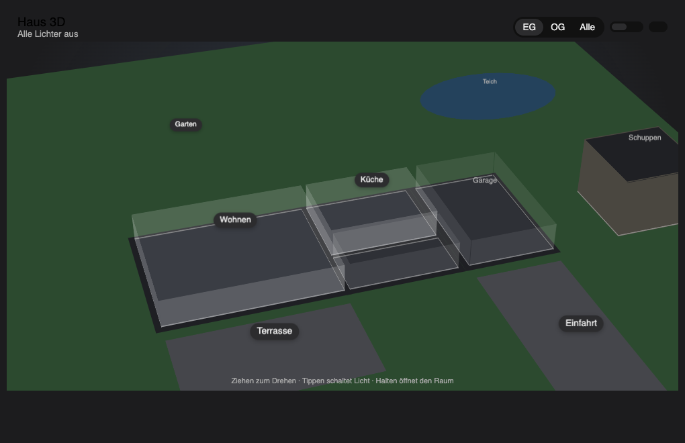

# House 3D Card

Interaktives 3D-Modell deines Hauses als Home-Assistant-Dashboard-Karte, in zwei Darstellungen:

| Schematisch | Realistisch |
|---|---|
|  |  |

- **Schematisch:** schnelles CSS-3D-Modell ohne Abhängigkeiten. Räume leuchten in der Farbe ihrer Lampen, es gibt eine Temperatur-Ansicht, Geschosse lassen sich einzeln oder gestapelt zeigen.
- **Realistisch:** three.js-Modell mit Wänden, Sattel-, Quer- und Zeltdächern, Bäumen, Büschen und Erdwällen. Die Schatten folgen dem echten Sonnenstand aus `sun.sun`, nachts hellt Mondlicht das Haus auf und die Fenster leuchten in der Farbe der Lampen dahinter. EG und OG lassen sich aufschneiden. Rasen, Pflaster und Beete liegen als klare Flächen auf dem Boden, wahlweise dient ein Luftbild als Boden.
- **Bedienung:** Ziehen dreht, Mausrad oder zwei Finger zoomen. Tippen schaltet das Licht im Raum, Halten öffnet die Raumseite, eine Kamera oder die Details.

Über den Knopf rechts oben wechselst du zwischen den Darstellungen. Die Wahl merkt sich der Browser.

## Installation über HACS

1. HACS → ⋮ → **Benutzerdefinierte Repositories** → `https://github.com/tbrtje/house-3d-card`, Typ **Dashboard**.
2. „House 3D Card“ herunterladen.
3. Falls HACS die Ressource nicht selbst einträgt: **Einstellungen → Dashboards → ⋮ → Ressourcen** → `/hacsfiles/house-3d-card/house-3d-card.js` als JavaScript-Modul.

three.js liegt im Repo und wird lokal von deinem Home Assistant geladen. Es gibt keine Anfragen ins Internet.

## Konfiguration

Ein vollständiges Beispiel steht in [`examples/simple-house.yaml`](examples/simple-house.yaml).

```yaml
type: custom:house-3d-card
title: Haus 3D
style: schematic        # Startdarstellung: schematic | realistic
height: 520             # Pixel oder CSS-Wert, z. B. "calc(100vh - 190px)"
house: { ... }          # Geometrie, siehe unten
rooms: { ... }          # Entitäten je Raum
outdoor: { zones: [...] }
```

Alle Maße sind Meter auf dem Grundriss: `x` nach rechts, `y` nach unten (im realistischen Modell heißt die zweite Achse `z`).

### `house`

| Schlüssel | Bedeutung |
|---|---|
| `north` | Kompassrichtung, in die „oben“ auf dem Grundriss zeigt (0 = Plan ist genordet, 90 = oben ist Osten). Steuert die Schatten. |
| `floors` | Liste der Geschosse: `name`, `level` (Fußbodenhöhe in m). Standard: EG und OG auf 2,95 m. |
| `rooms` | Räume: `id`, `name`, `floor` (Index, Standard 0), `p` (Innenumriss als Punktliste), optional `window: none \| small`. |
| `shell` | Außenkante der Außenwände als Punktliste. Nur für die realistische Darstellung. |
| `wall_height` | Höhe der Außenwände bis zur Traufe. |
| `wall_zones` | Abweichende Wandhöhen: `{ rect: [x0, y0, x1, y1], height }` oder `{ circle: [x, y, r], height }`. |
| `roofs` | `{ type: gable, rect, axis: x\|z, eave, ridge, overhang, windows }` für Satteldächer (`rect` = Wandrechteck, `axis` = Firstrichtung). `windows: true` setzt zwei Fenster und ein dreieckiges Giebelfenster unter den First, `windows: attic` nur das Giebelfenster, `windows: glazed` verglast den ganzen Giebel (Gauben). `open: true` und `posts: [[x, y], …]` ergeben ein offenes Dach auf Pfosten (Terrasse, Carport). `{ type: tent, center, ring, base, apex, overhang }` für Zeltdächer; `ring` darf vom Mauerwerk abweichen (achteckiges Dach über runder Wand). Quergiebel und Gauben sind Satteldächer, deren `rect` bis in das Hauptdach hineinreicht. |
| `doors` | `{ at: [x, y], width, height, sill }`, Türen auf der Außenwand; `sill` hebt eine Tür an (z. B. Bodentür im Giebel), `arch: true` gibt ihr einen Rundbogen mit verglastem Oberlicht und gemauertem Bogen, dazu Glasfelder in den Flügeln. |
| `windows` | Feste Fenster statt der automatischen: `{ at: [x, y], floor, width, height, sill, shape }`. `at` liegt auf der Außenwand, `sill` ist die Brüstungshöhe über dem Geschossboden, `shape: pointed` gibt eine Spitze wie beim Kirchenfenster. Sobald eine Wand ein festes Fenster eines Geschosses hat, entfallen dort die automatischen. `{ at, none: true }` schaltet sie ohne Ersatz ab. |
| `roof_windows` | Dachflächenfenster: `{ at: [x, y], width, height, floor }`. Sie liegen in der Dachfläche über `at` und leuchten mit dem Raum darunter. |
| `ortho` | Luftbild als Boden: `{ url, corners: [TL, TR, BR, BL], clip }` in Grundriss-Metern. Der Rand blendet weich in den Rasen über. `clip` (Punktliste, optional) zeigt nur das eigene Grundstück, Nachbarn werden ausgeblendet. |
| `plants` | Bäume und Büsche: `{ at: [x, y], r, h, kind: tree \| conifer \| shrub, color }`. `r` ist der Kronenradius, `h` die Höhe in Metern, `color` optional. |
| `materials` | Optional: `brick` (Liste von Klinkerfarben), `mortar`, `roof` (drei Farbtöne hell → dunkel), `paving` (Standardbelag der `paved`-Zonen, siehe unten). |

**Tipp:** Exakte Raumumrisse bekommst du aus einem PDF-Grundriss (`pdftocairo -svg plan.pdf plan.svg`), indem du die Pfade der Raumflächen ausliest und mit dem Planmaßstab in Meter umrechnest. Luftbilder gibt es in vielen Bundesländern kostenlos als Open Data (DOP-Orthofotos der Landesvermessungsämter).

### `rooms`

Schlüssel ist die Raum-`id` aus `house.rooms`.

| Schlüssel | Bedeutung |
|---|---|
| `name` | überschreibt den Namen aus `house.rooms` |
| `lights` | Lampen des Raums; Tippen schaltet alle zusammen |
| `temperature` | Temperatursensor |
| `motion` | Bewegungsmelder, pulsiert bei Bewegung |
| `window` | Fensterkontakt, Symbol bei offenem Fenster |
| `info` | weitere Zustände: Entität oder `{ entity, icon }` |
| `path` | Ziel beim Halten, z. B. eine Raumseite |
| `more_info` | Entität, deren Details beim Halten aufgehen (z. B. eine Kamera) |

### `outdoor.zones`

Flächen und Objekte rund ums Haus. Jede Zone hat `id`, optional `name`, eine Form (`rect`, `poly` oder `ellipse: [cx, cy, rx, ry]`) und `kind`:

| `kind` | Darstellung |
|---|---|
| `lawn`, `paved` (Standard), `road`, `bed` | flache Fläche. Sie liegen in Listenreihenfolge übereinander: eine Rasen-Insel nach dem Pflaster liegt obenauf. In der realistischen Darstellung nur ohne `house.ortho`. |
| `water`, `deck` | Teich, Holzdeck |

`paved`-Flächen haben einen Belag: `surface: slabs` (graue Platten, Standard), `clinker` (rotbrauner Pflasterklinker im Läuferverband mit Rollschicht am Rand), `concrete` (graues Betonpflaster) oder `gravel` (Kies). Ohne `surface` gilt `house.materials.paving`. Grenzen zwei Flächen mit gleichem Belag aneinander, gehen sie ohne Kante ineinander über.

| `building` | Nebengebäude mit Satteldach, `height`. `walls: brick` mauert es in Klinker mit Ziegeldach, `porch: <id einer deck-Zone>` zieht das Dach über diese Veranda und stellt Pfosten darunter. |
| `hedge` | Hecke, `height` |
| `mower` | Mähroboter mit Ladestation, gestaltet nach dem Husqvarna Automower 450X: `at: [x, y]` statt einer Form, `heading` (Blickrichtung der Nase in Grad, 0 = oben auf dem Plan, im Uhrzeigersinn, Station vor der Nase), `entity` (`lawn_mower.…`). Ist er angedockt, steht er auf der Station und das Ladelicht leuchtet, sonst steht die Station leer und er ein Stück davor auf dem Rasen. Die echte Position kennt die Karte nicht. Halten öffnet die Details. |
| `heatpump` | Außeneinheit einer Wärmepumpe, gestaltet nach der SolvisLea Pro 7 (117 × 73 × 96 cm): `at: [x, y]` (Mitte), `heading` (Richtung, in die das Lüftergitter zeigt, wie bei `mower`), optional `entity` für die Details beim Halten. |
| `stairs` | Außentreppe aus Stahl mit Gitterroststufen: `from` (Fuß des Laufs), `to` (oberste Stufe), `height`, `width` (Standard 0,8), `landing` (Podestlänge hinter `to`). Das Geländer kommt auf die Seite, die nicht an der Hauswand liegt. |
| `berm` | Erdwall entlang `line` (Mittellinie statt Form): `height`, `width` (Kronenbreite), `base` (Fußbreite). Pflanzen darauf stehen auf dem Wall, das Luftbild liegt darüber. |

Dazu `roof: <Höhe>` für überdachte Flächen und `label: [x, y]` oder `label: false`. Zonen können dieselben Entitäten haben wie Räume (`lights`, `motion`, `more_info`, …).

### Flächen aus dem Luftbild

`tools/ground_from_ortho.py` zeichnet Pflaster, Beete und Rasen-Inseln auf dem Luftbild nach und gibt sie als `outdoor.zones`-Liste aus. So bekommst du einen gezeichneten Boden statt des Fotos, und das Luftbild muss nicht unter `/local` liegen. Das Skript braucht dieselben Pakete wie das Pflanzen-Skript.

```sh
python3 tools/ground_from_ortho.py ortho.jpg \
  --corners "-20,-20 35,-20 35,30 -20,30" \
  --exclude "0,0 14,0 14,6 0,6" \
  --clip "-15,-15 30,-15 30,25 -15,25" \
  --preview vorschau.png > zones.json
```

Das Skript entscheidet nach dem Farbton, nicht nach der Helligkeit, deshalb zählen Schatten im Foto nicht. Schatten und `--exclude`-Flächen (Haus, Gartenhaus, Teich) übernehmen die Fläche drumherum, unter Bäumen und Hecken nimmt es Rasen an. Die Zonen kommen nach Größe sortiert heraus, die größte zuerst. Kopiere sie vor deine eigenen Zonen (Terrasse, Teich, …), dann liegen deine darüber. `--clip` beschränkt alles auf das eigene Grundstück, sonst landen auch Straße und Nachbardächer als Pflaster im Ergebnis. In `vorschau.png` siehst du die Umrisse: Pflaster weiß, Beete orange, Rasen grün. Die Polygone sind ein Vorschlag, nachbessern kannst du sie im YAML.

### Bäume und Büsche aus dem Luftbild

`tools/plants_from_ortho.py` sucht Gehölze auf dem Luftbild und gibt sie als `plants`-Liste aus. Dafür braucht das Skript Pillow, NumPy und SciPy.

```sh
python3 tools/plants_from_ortho.py ortho.jpg \
  --corners "-20,-20 35,-20 35,30 -20,30" \
  --exclude "0,0 14,0 14,6 0,6" \
  --preview vorschau.png > plants.json
```

`--corners` sind dieselben Ecken wie bei `house.ortho`. Mit `--exclude` (mehrfach möglich) nimmst du Haus, Gartenhaus oder Teich aus, damit dort nichts wächst. `--clip` (dieselbe Punktliste wie `ortho.clip`) behält nur Pflanzen auf dem eigenen Grundstück. In `vorschau.png` siehst du, was erkannt wurde: Bäume magenta, Nadelbäume türkis, Büsche gelb. Hecken werden zu Reihen aus Büschen.

**Passt das Luftbild nicht genau?** Normale Orthofotos zeigen hohe Dächer leicht schräg versetzt. Richte das Bild deshalb an Bodenmerkmalen wie Wegen, Zäunen oder Beeten aus, nicht am Dachfirst, und verschiebe dafür alle vier Ecken um denselben Betrag.

## Datenschutz

Die Karte enthält keine Hausdaten. Grundriss und Entitäten stehen in deiner Dashboard-Konfiguration, die Home Assistant nur angemeldeten Benutzern ausliefert. Dateien unter `/config/www` (`/local/…`) sind dagegen ohne Anmeldung abrufbar. Lege dort nichts ab, was nicht öffentlich sein soll.

## Lizenz

MIT, siehe [LICENSE](LICENSE). three.js: siehe [THIRD_PARTY_NOTICES.md](THIRD_PARTY_NOTICES.md).
