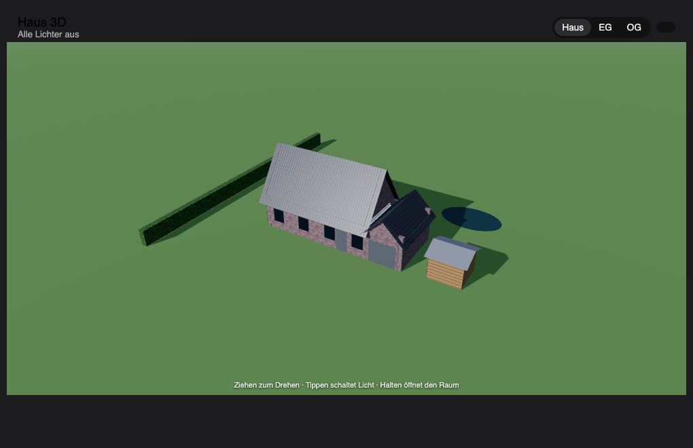

# House 3D Card

Interaktives 3D-Modell deines Hauses als Home-Assistant-Dashboard-Karte, in zwei Darstellungen:

| Schematisch | Realistisch |
|---|---|
|  |  |

- **Schematisch:** schnelles CSS-3D-Modell ohne Abhängigkeiten. Räume leuchten in der Farbe ihrer Lampen, es gibt eine Temperatur-Ansicht, Geschosse lassen sich einzeln oder gestapelt zeigen.
- **Realistisch:** three.js-Modell mit Wänden, Satteldächern und Zeltdächern. Die Schatten folgen dem echten Sonnenstand aus `sun.sun`, abends leuchten die Fenster in der Farbe der Lampen dahinter. EG und OG lassen sich aufschneiden, ein Luftbild kann als Boden dienen.
- **Bedienung:** Ziehen dreht, Mausrad oder zwei Finger zoomen. Tippen schaltet das Licht im Raum, Halten öffnet die Raumseite, eine Kamera oder die Details.

Über den Knopf rechts oben wechselst du zwischen den Darstellungen. Die Wahl merkt sich der Browser.

## Installation über HACS

1. HACS → ⋮ → **Benutzerdefinierte Repositories** → `https://github.com/tbrtje/house-3d-card`, Typ **Dashboard**.
2. „House 3D Card“ herunterladen.
3. Falls HACS die Ressource nicht selbst einträgt: **Einstellungen → Dashboards → ⋮ → Ressourcen** → `/hacsfiles/house-3d-card/house-3d-card.js` als JavaScript-Modul.

three.js liegt im Repo und wird lokal von deinem Home Assistant geladen. Es gibt keine Anfragen ins Internet.

## Konfiguration

Ein vollständiges Beispiel steht in [`examples/simple-house.yaml`](examples/simple-house.yaml).

```yaml
type: custom:house-3d-card
title: Haus 3D
style: schematic        # Startdarstellung: schematic | realistic
height: 520             # Pixel oder CSS-Wert, z. B. "calc(100vh - 190px)"
house: { ... }          # Geometrie, siehe unten
rooms: { ... }          # Entitäten je Raum
outdoor: { zones: [...] }
```

Alle Maße sind Meter auf dem Grundriss: `x` nach rechts, `y` nach unten (im realistischen Modell heißt die zweite Achse `z`).

### `house`

| Schlüssel | Bedeutung |
|---|---|
| `north` | Kompassrichtung, in die „oben“ auf dem Grundriss zeigt (0 = Plan ist genordet, 90 = oben ist Osten). Steuert die Schatten. |
| `floors` | Liste der Geschosse: `name`, `level` (Fußbodenhöhe in m). Standard: EG und OG auf 2,95 m. |
| `rooms` | Räume: `id`, `name`, `floor` (Index, Standard 0), `p` (Innenumriss als Punktliste), optional `window: none \| small`. |
| `shell` | Außenkante der Außenwände als Punktliste. Nur für die realistische Darstellung. |
| `wall_height` | Höhe der Außenwände bis zur Traufe. |
| `wall_zones` | Abweichende Wandhöhen: `{ rect: [x0, y0, x1, y1], height }` oder `{ circle: [x, y, r], height }`. |
| `roofs` | `{ type: gable, rect, axis: x\|z, eave, ridge, overhang, windows }` für Satteldächer (`rect` = Wandrechteck, `axis` = Firstrichtung, `windows: true` setzt Fenster in die Giebel), `{ type: tent, center, ring, base, apex, overhang }` für Zeltdächer. |
| `doors` | `{ at: [x, y], width, height }`, Türen auf der Außenwand. |
| `ortho` | Luftbild als Boden: `{ url, corners: [TL, TR, BR, BL] }` in Grundriss-Metern. |
| `materials` | Optional: `brick` (Liste von Klinkerfarben), `mortar`, `roof` (drei Farbtöne hell → dunkel). |

**Tipp:** Exakte Raumumrisse bekommst du aus einem PDF-Grundriss (`pdftocairo -svg plan.pdf plan.svg`), indem du die Pfade der Raumflächen ausliest und mit dem Planmaßstab in Meter umrechnest. Luftbilder gibt es in vielen Bundesländern kostenlos als Open Data (DOP-Orthofotos der Landesvermessungsämter).

### `rooms`

Schlüssel ist die Raum-`id` aus `house.rooms`.

| Schlüssel | Bedeutung |
|---|---|
| `name` | überschreibt den Namen aus `house.rooms` |
| `lights` | Lampen des Raums; Tippen schaltet alle zusammen |
| `temperature` | Temperatursensor |
| `motion` | Bewegungsmelder, pulsiert bei Bewegung |
| `window` | Fensterkontakt, Symbol bei offenem Fenster |
| `info` | weitere Zustände: Entität oder `{ entity, icon }` |
| `path` | Ziel beim Halten, z. B. eine Raumseite |
| `more_info` | Entität, deren Details beim Halten aufgehen (z. B. eine Kamera) |

### `outdoor.zones`

Flächen und Objekte rund ums Haus. Jede Zone hat `id`, optional `name`, eine Form (`rect`, `poly` oder `ellipse: [cx, cy, rx, ry]`) und `kind`:

| `kind` | Darstellung |
|---|---|
| `lawn`, `paved` (Standard), `road`, `water`, `deck` | Fläche |
| `building` | Nebengebäude mit Satteldach, `height` |
| `hedge` | Hecke, `height` |

Dazu `roof: <Höhe>` für überdachte Flächen und `label: [x, y]` oder `label: false`. Zonen können dieselben Entitäten haben wie Räume (`lights`, `motion`, `more_info`, …).

## Datenschutz

Die Karte enthält keine Hausdaten. Grundriss und Entitäten stehen in deiner Dashboard-Konfiguration, die Home Assistant nur angemeldeten Benutzern ausliefert. Dateien unter `/config/www` (`/local/…`) sind dagegen ohne Anmeldung abrufbar. Lege dort nichts ab, was nicht öffentlich sein soll.

## Lizenz

MIT, siehe [LICENSE](LICENSE). three.js: siehe [THIRD_PARTY_NOTICES.md](THIRD_PARTY_NOTICES.md).
